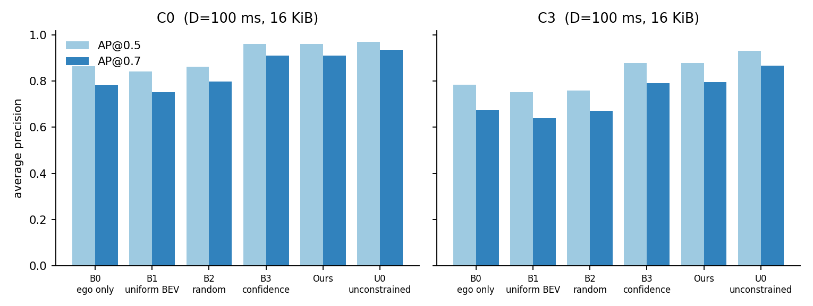
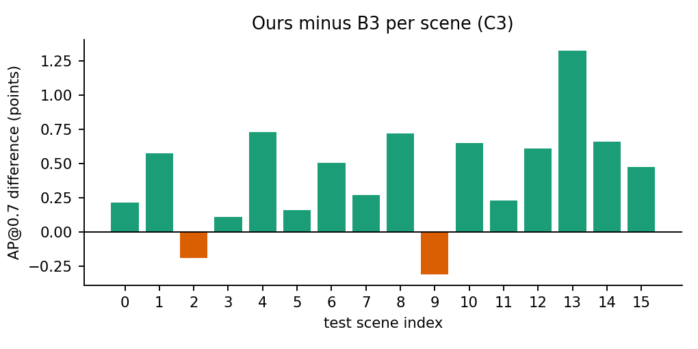
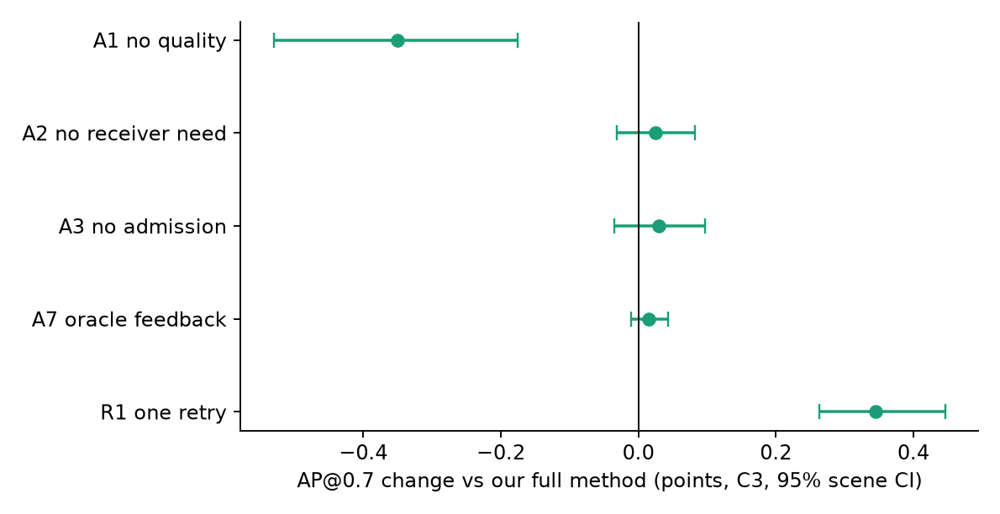
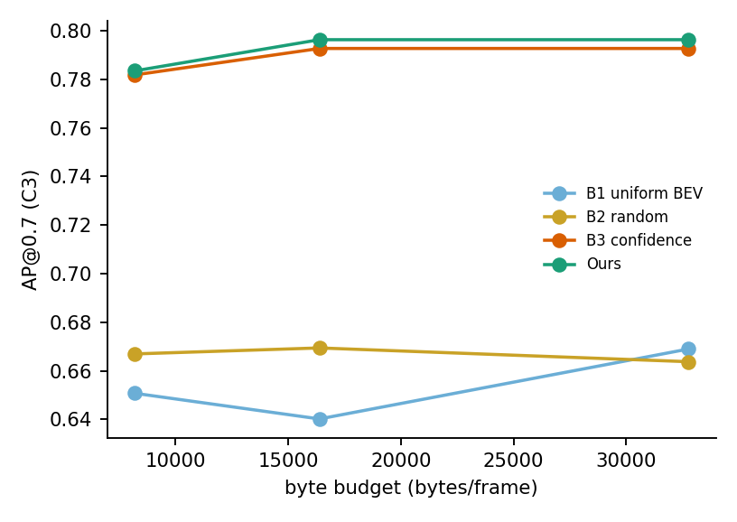
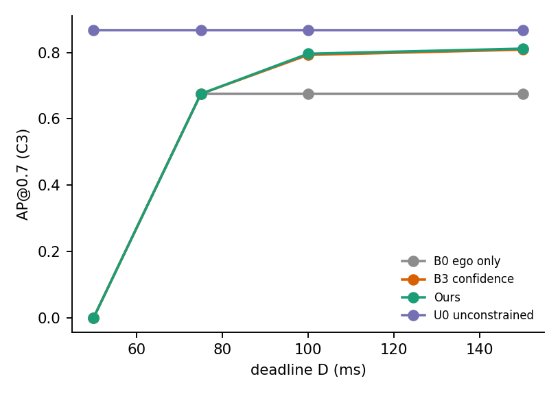
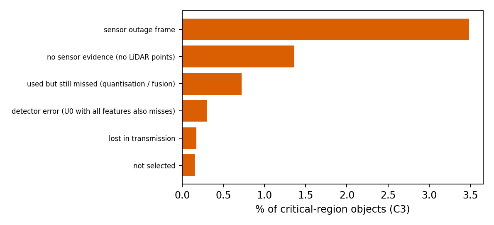
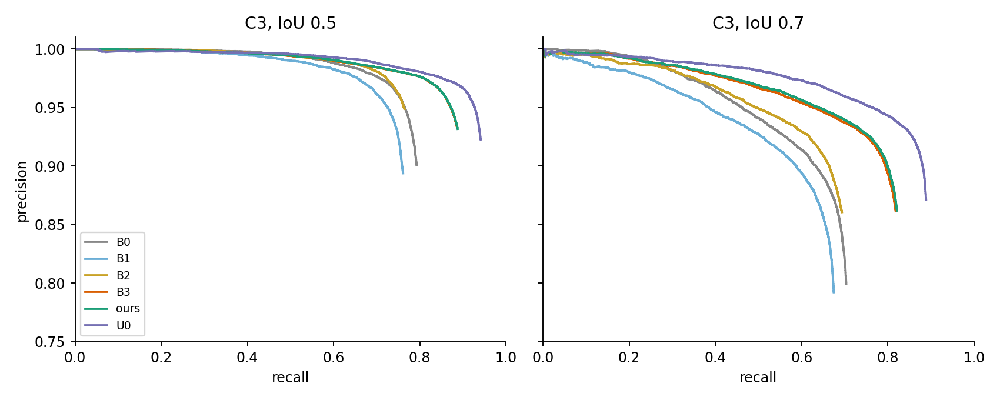
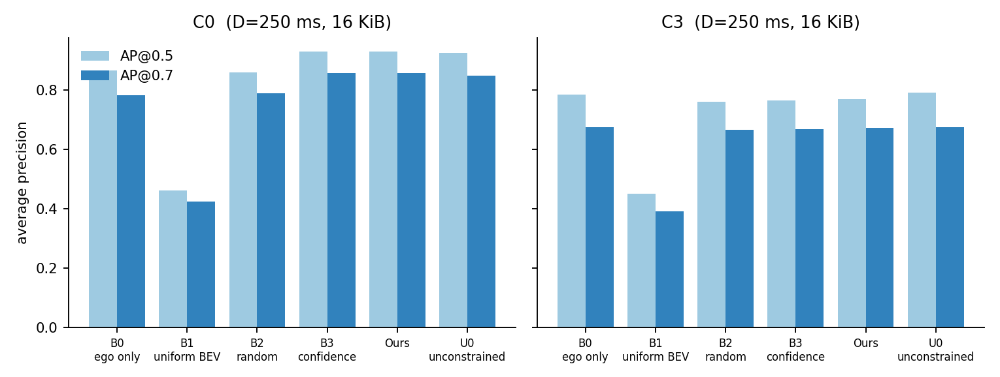
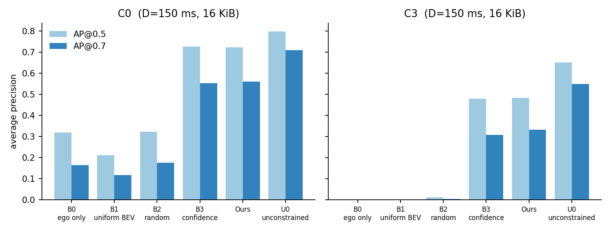

# Phase 3 Report — Implementation and Experimental Evaluation

**Project:** A Unified Task-Oriented Multimodal Semantic Communication Framework in 6G Networks (autonomous-vehicle cooperative perception)
**Team:** Hassan Ali (24I-0047), Muhammad Saad (24I-0058) — Computer Networks, Ms. Laraib Afzal
**Date of results:** 15 November 2026. Every number below comes from a saved log in `phase3_outputs/data/` (files named in brackets). Nothing was tuned on the test data.

---

## 0. The whole project in plain words

Two cars each see part of the road. Car B can send car A a few small pieces ("tiles") of what it sees, a top-down feature map (BEV). The link has a byte limit and a time limit.
We ask: **which tiles are worth sending, and should we send them at all if they would arrive too late?** We score the detection accuracy of *whatever result is ready at the deadline*.

**What we built:** a tile-selection and deadline-admission policy ("ours") plus an evaluation protocol that measures AP at the deadline, on top of a frozen, pretrained HEAL detector (we did not train anything).

**What we found, in four sentences**

1. Sending information helps a lot (+12 AP points over ego-only with two LiDAR cars on a bad link), but *how* you choose the tiles matters: random or uniformly compressed sharing is **worse than sending nothing** with the frozen detector.
2. Our policy beats the confidence-only comparator by a small but statistically reliable margin (+0.40 AP@0.7 points, 95% interval [+0.23, +0.59], 10 link traces) and sends about 35% fewer bytes on the bad link.
3. Almost all of that gain comes from the **sender-quality term**; the receiver-need term and deadline admission change bytes, not accuracy. Our hypothesis H2 is **not supported**.
4. The gain is much larger when the receiving car has a weak sensor: with a camera-only ego car the policy gains **+2.4 AP points** over confidence-only, and a LiDAR collaborator lifts a degraded camera car from AP 0.000 to 0.33.

---

## 1. What was implemented

| Component | What it does | File |
|---|---|---|
| Frozen detector | Official `HEAL_OPV2V` checkpoint (`heter_pyramid_collab`, PointPillar LiDAR m1, Lift-Splat-Shoot camera m2). **No training.** | `opencood/logs/final_infer` |
| Stage 1 — feature extraction | Runs each car's encoder once and caches the 64×100×176 BEV features (clean and degraded) plus quality proxies and poses | `extract_features.py` |
| Stage 2 — replay engine | For each frame, method and condition: scores tiles, applies the byte cap and deadline admission, packetises (4 tokens/packet), simulates loss/queue/serialisation, replays the fusion and detection at the deadline | `replay2.py` |
| Stage 3 — analysis | AP@0.3/0.5/0.7, critical-region recall, bytes, paired bootstrap, tables and figures | `analyze.py`, `paired.py`, `sens_table.py`, `failure_analysis.py` |
| Policy | tile score s = a·r·p·(1+λc·c)·[ε+(1−ε)(1−e)]·exp(−age/τ), critical region 0<x<40 m, \|y\|<10 m; deadline admission `t_ready + queue + 8·L(K)/rate + T_res ≤ D`; ego-only fallback | `ours_pkg`, `replay2.py` |

Tile geometry: 2×2 cells (1.6 m) → 50×88 = 4,400 tiles; token = 256 int8 values + 6 B metadata = 262 B; 4 tokens/packet; 72 B per-packet overhead; 584 B feedback; byte cost L(K) = 262·K + 72·⌈K/4⌉. 56 tokens + feedback = 16,264 B ≤ 16 KiB.

### Dataset and preprocessing
- OPV2V official **test split**: 16 scenes, 2,170 frames (no validation split was downloaded, so nothing is tuned; all settings are the Phase 2 defaults).
- Evaluation range x ±70.4 m, y ±40 m (Phase 2 preprocessing). One fixed car pair per scene (the two cars with the smallest mean distance, chosen from poses only, before any result). One scene has only two cars >70 m apart for 119 of 178 frames; those frames are ego-only for every method.
- Degradation: **C1** = both cars' LiDAR keeps 50% of points + outage bursts (3 frames) on 10% of frames; camera degradation = brightness ×0.5 and Gaussian blur σ=1.5 px. **C2** = 5 Mb/s, 10% packet loss, 20 ms queue. **C3 = C1 + C2** (main). **C0** = clean.
- Timing is **emulated**: each stage was measured on the RTX 5050 laptop and replayed in a discrete-event timeline (`timing_ll.json`: LiDAR encoder 9.7 ms, selection 2.0 ms, receiver p95 50.4 ms, ego result ≈52 ms; camera encoder 68.7 ms in `timing.json`).

### Fairness
Every method sees the same frames, same pairs, same loss draws (common random numbers via SHA-256), same byte cap and same deadline; the same detector evaluates all of them. Statistics: scene-level paired bootstrap (2,000 resamples over 16 scenes), a labelled frame-block bootstrap, Holm correction over the test family.

### Instructor feedback and how it was incorporated
The instructor approved the Phase 3 direction (13 Nov 2026) and asked us to (a) **clearly establish the novelty** of the approach, (b) **substantiate the research gap through a strong comparison with existing work**, and (c) keep the experiments and evaluation criteria **rigorous and well-defined**.
- (a) and (b): new Section 6.1 compares our design with the seven closest papers found since Phase 2 (Where2comm, CoSDH, WhisperNet, CooperTrim, TAMP, Fresh2comm, JigsawComm), axis by axis, and states what we do and do not claim as new.
- (c): the metric, conditions, baselines, hypotheses and decision rules were fixed in Phase 2 and not changed; nothing was tuned on test data; every comparison uses paired scene-bootstrap intervals with Holm correction; every deviation is logged in `PHASE3_CHANGES_LOG.md` and Section 10.

### Deviations from Phase 2
All deviations are listed with reasons in `PHASE3_CHANGES_LOG.md` (frozen model, hand-made quality proxy, no validation split, sensor assignment, emulated timing, cut baseline B4 PragComm, causal feedback, camera crop-mask fix). The two that matter most for interpretation: **no training**, and **emulated timing**.

---

## 2. Baselines and ablations

| ID | Meaning |
|---|---|
| B0 | ego only (no communication) |
| B1 | uniform BEV compression (block-averaged tokens, finest resolution that fits the budget) |
| B2 | random tiles |
| B3 | **confidence-only** tiles (main comparator; the sender's own occupancy score) |
| U0 | unconstrained reference (all tiles, instant link). A diagnostic, **not** an upper bound |
| Ours | quality × confidence × receiver need × critical region, with deadline admission |
| A1 / A2 / A3 | ours without quality / without receiver need / without admission |
| A7 | oracle same-frame feedback (shows what causality costs) |
| R1 | ours + one retransmission of lost packets |
| B4 PragComm | **cut** (no time; disclosed) |

---

## 3. Experiment 2 (main): LiDAR ego + LiDAR collaborator

Primary operating point: C3, D = 100 ms, 16 KiB, AP@0.7. [`main_table.csv`, `tests.json`]

| Method | C3 AP@0.5 | C3 AP@0.7 | C3 critical recall | C3 bytes/frame | C0 AP@0.7 |
|---|---|---|---|---|---|
| B0 ego only | 0.785 | 0.675 | 0.730 | 0 | 0.783 |
| B1 uniform BEV | 0.752 | 0.640 | 0.722 | 11,278 | 0.752 |
| B2 random | 0.760 | 0.669 | 0.743 | 14,506 | 0.798 |
| B3 confidence-only | 0.878 | 0.793 | 0.928 | 14,506 | 0.910 |
| **Ours** | **0.880** | **0.796** | **0.937** | **9,415** | **0.911** |
| U0 unconstrained | 0.933 | 0.867 | 0.968 | – | 0.936 |

Paired scene-bootstrap differences (AP@0.7, points):

| Test | Δ | 95% CI (scene) | Holm p |
|---|---|---|---|
| **H1: ours − B3, C3 (10 traces, pre-declared)** | **+0.40** | **[+0.23, +0.59]** | <0.001 |
| ours − B3, C3 (3 traces) | +0.36 | [+0.20, +0.53] | 0.001 |
| ours − B3, C3, AP@0.5 | +0.15 | [+0.01, +0.28] | 0.175 (not significant after Holm) |
| ours − B0 (ego only), C3 | +12.11 | [+10.05, +14.34] | <0.001 |
| ours − B2 (random), C3 | +12.69 | [+10.86, +14.79] | <0.001 |
| ours − B1 (uniform), C3 | +15.61 | [+13.01, +18.37] | <0.001 |
| U0 − B0, C0 (value of cooperation) | +15.34 | [+12.39, +18.46] | <0.001 |

*Figure F1. Main comparison (LiDAR pair, D = 100 ms, 16 KiB). Random (B2) and uniform (B1) sharing fall below ego-only (B0) in C3.*

*Figure F5. Ours − B3 per test scene in C3: positive in 14 of 16 scenes, small everywhere.*

**Reading:** cooperation is worth 12 to 15 AP points, so the communication problem is real. Our policy is reliably better than the strongest simple comparator, but only by 0.4 points. The hoped-for 3 points (a "practical target", not a claim) was **not reached** here.
Random and uniform sharing score *below* ego-only (0.669 and 0.640 vs 0.675): the frozen fusion network was never trained on sparse or compressed features, so bad tiles actively hurt. Choosing tiles well is therefore a necessary condition for any benefit.

### 3.1 Hypotheses (decided as in Phase 2, nothing redefined)
- **H1 (ours > B3 in C3): supported** (+0.40, interval above zero), but small.
- **H2 (admission raises critical-region recall): not supported.** Recall with admission 0.937 vs without 0.938; ΔAP −0.03 [−0.10, +0.04]. Admission saves bytes, not accuracy.
- **H3 (clean non-inferiority, ≤1 point): supported** (ours − B3 on C0 = +0.05 [−0.08, +0.17]). The "≥25% fewer bytes at matched AP" target is met on the lossy link (9,415 vs 14,506 B = **35% fewer**, with equal or higher AP) but **not** on a clean link (15,372 vs 15,383 B, because admission never binds there).

### 3.2 Ablations (C3, AP@0.7, vs ours)
| Variant | AP@0.7 | Variant − ours (points) | Verdict |
|---|---|---|---|
| A1 no quality | 0.793 | −0.35 [−0.53, −0.18] | **quality term is what helps** |
| A2 no receiver need | 0.797 | +0.02 [−0.03, +0.08] | no accuracy effect (it sends 6% fewer bytes: 8,894 vs 9,415, i.e. the need term makes the policy send a little more, to no benefit); on C0 it is slightly *better* without need (−0.11 [−0.18, −0.05]) |
| A3 no admission | 0.797 | +0.03 [−0.04, +0.10] | no accuracy effect; sends 54% more bytes |
| A7 oracle feedback | 0.796 | +0.02 [−0.01, +0.04] | causal (previous-frame) feedback costs nothing |
| R1 +1 retry | 0.800 | +0.35 [+0.26, +0.45] | one retry of lost packets is worth +0.35 for ~265 B/frame |

*Figure F4b. Only removing quality (A1) and adding a retry (R1) move AP; the intervals for no-need, no-admission and oracle feedback include zero.*

### 3.3 Sweeps (one factor at a time; reported as sweeps, never used to pick a value)
**Byte budget (C3, D=100, AP@0.7)** [`sweep_budget.pkl`]

| Budget | B1 | B2 | B3 | Ours | bytes (B3 / ours) |
|---|---|---|---|---|---|
| 8 KiB | 0.651 | 0.667 | 0.782 | 0.783 | 7,285 / 7,274 |
| 16 KiB | 0.640 | 0.669 | 0.793 | 0.796 | 14,506 / 9,415 |
| 32 KiB | 0.669 | 0.664 | 0.793 | 0.796 | 28,948 / 9,415 |

*Figure F3. AP versus byte budget (C3).*

AP saturates by 16 KiB for the frozen detector. B3 would spend 29 KB for nothing; ours sends 9.4 KB because admission refuses tokens that cannot arrive in time.

**Deadline (C3, 16 KiB)** [`sweep_deadline.pkl`]

| D | B0 | B3 | Ours | A3 | R1 | U0 |
|---|---|---|---|---|---|---|
| 50 ms | 0.000 | 0.000 | 0.000 | 0.000 | 0.000 | 0.867 |
| 75 ms | 0.675 | 0.675 | 0.675 | 0.675 | 0.675 | 0.867 |
| 100 ms | 0.675 | 0.793 | 0.796 | 0.797 | 0.800 | 0.867 |
| 150 ms | 0.675 | 0.809 | 0.812 | 0.812 | 0.812 | 0.867 |

*Figure F2. AP versus deadline (C3). Below about 100 ms no cooperative result is ready, so all methods fall back to ego-only (75 ms) or output nothing (50 ms).*

At 50 ms even the ego-only result is not ready (≈52 ms), so every method outputs an empty prediction (objects stay in the denominator). At 75 ms no cooperative result can be ready (≈100 ms), so everyone falls back to ego-only. Under those two deadlines our method correctly sends almost nothing (520 B/frame vs 14.5 KB for B3, which wastes the whole link).

**Single-factor conditions (D=100, 16 KiB, AP@0.7)** [`sweep_C1C2.pkl`]

| Condition | B0 | B2 | B3 | Ours | U0 |
|---|---|---|---|---|---|
| C1 degraded sensors, good link | 0.675 | 0.676 | 0.819 | 0.821 | 0.867 |
| C2 clean sensors, bad link | 0.783 | 0.793 | 0.893 | 0.895 | 0.936 |

On C2 ours sends 9,983 B vs 15,383 B (35% fewer) at the same accuracy.

**Link parameters around C3** [`sens_link_table.csv`; AP@0.7 B3 / ours; every 1 frame, 2 traces]

| Factor | Value | B3 | Ours | Ours bytes (B3 sends 14,566) |
|---|---|---|---|---|
| Rate | 1 Mb/s | 0.688 | **0.709** | 2,889 (−80%) |
| Rate | 10 / 20 Mb/s | 0.809 | 0.811 | 14,416 / 14,485 |
| Loss | 0 / 5 / 10 / 20 % | 0.802 / 0.797 / 0.793 / 0.780 | 0.808 / 0.802 / 0.796 / 0.780 | 10,311 / 9,931 / 9,482 / 8,580 |
| Queue | 0 / 10 ms | 0.809 / 0.809 | 0.812 / 0.811 | 14,555 / 14,358 |
| Queue | 40 ms | 0.676 | 0.676 | **523** (B3 wastes 14,566) |

Admission matters on a very slow link (1 Mb/s: +2.1 points and 80% fewer bytes) and when nothing can arrive (40 ms queue: no wasted traffic).

**Quantisation, ε, λc** (every 2nd frame, 2 traces, C3 link) [`sens_params`]

| Setting | B3 | Ours |
|---|---|---|
| 8-bit (default) | 0.793 | 0.796 |
| 4-bit | 0.813 | 0.816 |
| 16-bit | 0.761 | 0.760 |
| ε = 0.2 | – | 0.796 |
| λc = 0 / 2 | – | 0.795 / 0.795 |

With a fixed byte budget, coarser quantisation fits more tokens and gives *higher* AP (4-bit +2 points). ε and λc make no practical difference.

### 3.4 Stress test (held-out harsher condition)
LiDAR keeps 30% of points on both cars, outage bursts on 30% of frames, the Phase 2 default operating point (nothing tuned). [`stress.pkl`]

| Condition | B0 | B2 | B3 | Ours | A1 | A3 | U0 |
|---|---|---|---|---|---|---|---|
| ST (bad link) AP@0.7 | 0.505 | 0.497 | 0.628 | **0.635** | 0.630 | 0.636 | 0.742 |
| ST1 (good link) AP@0.7 | 0.505 | 0.502 | 0.659 | **0.666** | 0.660 | 0.666 | 0.742 |

Paired scene bootstrap (2,000 resamples): ours − B3 = **+0.73 [+0.49, +1.01]** (ST) and **+0.71 [+0.47, +0.99]** (ST1); ours − A1 (no quality) = +0.54 [+0.38, +0.72]; ours − A3 (no admission) = −0.06 [−0.10, −0.02] (admission costs 0.06 points here while saving 35% bytes); ours − B0 = +13.00 [+11.03, +15.17].
The ranking is unchanged and the quality gain is somewhat larger under harsher sensing than in C3 (+0.73 vs +0.40), which is consistent with quality estimates mattering more when sensors are worse. The stress condition was run once with the default operating point and not tuned.

### 3.5 Failure analysis (C3, D=100, IoU 0.5, trace 0) [`failure_analysis.json`, `F7_failure_analysis.png`]
Of 8,722 critical-region objects, ours detects 8,182 (**93.8%**). The 6.2% that are missed:

| Cause | Objects | Share of all |
|---|---|---|
| Sensor outage frame | 304 | 3.5% |
| No LiDAR evidence (no points on the object) | 119 | 1.4% |
| Used but still missed (quantisation / fusion) | 63 | 0.7% |
| Detector error even with all features (U0 also misses) | 26 | 0.3% |
| Lost in transmission | 15 | 0.2% |
| Not selected | 13 | 0.1% |

*Figure F7. Why critical-region objects are missed (C3). Sensor limits dominate; communication causes about 0.3%.*

Cooperation recovers 1,832 objects that ego-only misses. Only **0.3%** of critical objects are missed because of the communication choices (lost or not selected); the remaining misses are sensing limits. At this budget the selector is not the bottleneck, which explains why accuracy differences between selectors are small.

### 3.6 Precision, recall and F1 [`precision_recall.csv`, `F8_precision_recall.png`, `precision_recall.py`]
For object detection the standard accuracy measure is **average precision (AP)**, which is the area under the precision-recall curve. Plain "accuracy" (correct ÷ total) is not defined for detection because there is no count of empty space correctly rejected. To show the precision and recall behind AP, we computed them from the saved detections (pooled over all frames and 3 link traces; C3, D = 100 ms, 16 KiB) at a **fixed confidence threshold of 0.5, chosen in advance and not tuned**. These are descriptive numbers without intervals; the AP recomputed from the same detections reproduces the tables above (ours 0.796, B3 0.793, B0 0.675, U0 0.867 at IoU 0.7).

| Method (C3) | IoU 0.5: precision / recall / F1 | IoU 0.7: precision / recall / F1 |
|---|---|---|
| B0 ego only | 0.984 / 0.645 / 0.779 | 0.914 / 0.599 / 0.724 |
| B1 uniform | 0.989 / 0.526 / 0.686 | 0.928 / 0.493 / 0.644 |
| B2 random | 0.992 / 0.561 / 0.717 | 0.944 / 0.533 / 0.682 |
| B3 confidence | 0.985 / 0.699 / 0.817 | 0.943 / 0.669 / 0.783 |
| **Ours** | 0.984 / **0.704** / **0.821** | 0.944 / **0.675** / **0.787** |
| U0 unconstrained | 0.982 / 0.783 / 0.871 | 0.951 / 0.758 / 0.844 |

*Figure F8. Precision-recall curves in C3 (y-axis starts at 0.75). Curves that extend further right find more vehicles.*

**Reading.** Precision is high for every method (about 0.98 at IoU 0.5 and 0.94 at IoU 0.7): the frozen detector rarely reports objects that are not there. What cooperation changes is **recall**, the share of vehicles found: from 0.645 (ego only) to 0.704 (ours) at IoU 0.5, because the helper car shows the ego car vehicles it cannot see. Ours and B3 have the same precision and ours has slightly higher recall (+0.5 points), matching the small AP gain. B1 and B2 have slightly higher precision but much lower recall, because they deliver fewer or less useful tiles. In clean conditions (C0, IoU 0.5) recall is 0.752 for ego only and 0.836 for ours, with precision about 0.98 for both.

---

## 4. Experiment 1: LiDAR ego + camera collaborator (D = 250 ms, 16 KiB)

A camera collaborator needs about 69 ms just to encode, so D = 100 ms is infeasible; we use D = 250 ms. [`cc/*.pkl`, `final/cc`]
Camera degradation = brightness ×0.5 and blur; the ego LiDAR is also degraded in C3.

| Method | C0 AP@0.7 | C3 AP@0.7 | C3 critical recall |
|---|---|---|---|
| B0 ego only | 0.783 | 0.674 | 0.730 |
| B1 uniform | 0.424 | 0.391 | 0.456 |
| B2 random | 0.789 | 0.666 | 0.728 |
| B3 confidence | 0.858 | 0.668 | 0.742 |
| **Ours** | **0.858** | **0.672** | **0.756** |
| U0 unconstrained | 0.850 | 0.675 | 0.749 |

*Figure (Experiment 1). LiDAR ego + camera collaborator, D = 250 ms.*

- **Clean data:** a camera collaborator adds **+6.7 AP points** (U0 − B0 [+4.99, +8.60]); selected tiles (0.858) are as good as, or better than, sending everything (0.850).
- **Degraded:** cooperation gives **no benefit** (ours − B0 = −0.22 [−1.02, +0.60]); confidence-only sharing is slightly harmful (B3 − B0 = −0.56 [−1.27, +0.13]).
- Our policy beats B3 by +0.34 [+0.09, +0.66] (Holm p = 0.024), because the camera-quality proxy avoids bad tiles. It does not turn a bad camera into a useful one.
- Uniform compression of camera features is destructive (−28 points vs ours).

**Honest correction we made:** our first camera diagnostic showed no camera benefit and we wrongly concluded "frozen HEAL ignores camera collaborators". The real cause was a **HEAL crop-mask bug**: at our non-square range, `start_h = H//2 − crop_H//2` is −12, which Python reads as "from the end", masking 92% of the camera map. We clamped the indices and re-ran every camera experiment; all earlier camera runs were moved to `INVALID_cropbug/` and are not used. LiDAR experiments were never affected.

---

## 5. Experiment 3: camera ego + LiDAR collaborator (the realistic multimodal case)

A weak camera-only ego car receives LiDAR tiles. D = 150 ms (D = 100 ms is infeasible because the ego camera encoder alone takes ~65 ms). [`ec/*.pkl`, `final/ec`]

| Method (D = 150) | C0 AP@0.7 | C3 AP@0.7 | C3 critical recall |
|---|---|---|---|
| B0 ego only (camera) | 0.164 | **0.000** | 0.026 |
| B1 uniform | 0.117 | 0.000 | 0.004 |
| B2 random | 0.175 | 0.003 | 0.066 |
| B3 confidence | 0.553 | 0.307 | 0.653 |
| **Ours** | 0.560 | **0.332** | **0.672** |
| A1 no quality | 0.553 | 0.317 | 0.665 |
| A2 no receiver need | **0.564** | 0.334 | 0.674 |
| U0 unconstrained | 0.710 | 0.550 | 0.770 |

*Figure (Experiment 3). Camera ego + LiDAR collaborator, D = 150 ms. Ego-only is 0.000 in C3; LiDAR tiles lift it to 0.33.*

- A camera-only ego car is very weak (AP@0.7 = 0.164 clean, 0.000 degraded). LiDAR tiles from a collaborator lift it to 0.560 (clean) and 0.332 (degraded). U0 − B0 on clean = +54.5 [+44.3, +63.7].
- **H1 holds with a larger effect:** ours − B3 = **+2.42 [+1.75, +3.33]** (Holm p < 0.001). The quality term accounts for +1.51 [+1.10, +1.90] of it.
- The receiver-need term is slightly *harmful*: ours − A2 = −0.25 [−0.39, −0.10] (C3) and −0.40 [−0.52, −0.29] (C0). The feedback map is made from a weak camera detector, so it is a poor guide to what the ego car lacks.
- Admission has no effect on accuracy (identical AP and critical recall to A3).
- At D = 100 ms no cooperative result can be ready, so every method falls back to ego-only (the fallback rule working).
- A large gap remains to U0 (0.332 vs 0.550): a 16 KiB budget carries only 56 tokens. A budget sweep for this case (C3, D = 150 ms, AP@0.7, pooled 16 scenes, 3 traces) [`ecb/*.pkl`] shows the selector matters across budgets:

| Budget | B2 random | B3 confidence | Ours | Ours − B3 (95% scene CI) | bytes (B3 / ours) |
|---|---|---|---|---|---|
| 8 KiB | 0.001 | 0.223 | 0.239 | +1.59 [+1.06, +2.21] | 7,285 / 7,274 |
| 16 KiB | 0.003 | 0.307 | 0.332 | +2.42 [+1.75, +3.33] | 14,506 / 14,495 |
| 32 KiB | 0.012 | 0.348 | 0.368 | +1.98 [+1.47, +2.65] | 28,948 / 29,001 |
| 64 KiB | 0.039 | 0.363 | 0.379 | +1.56 [+1.06, +2.14] | 58,193 / 37,997 |

AP keeps rising with budget (0.332 → 0.379) but stays far below U0 (0.550), so for a weak camera ego car the limit is the number of tokens, not only which ones. At 64 KiB admission stops sending once the extra tokens could not arrive in time (38 KB vs 58 KB) with no accuracy loss.

---

## 6. Comparison with existing research

### 6.1 Novelty: how our design differs from the closest existing work

We read the abstract and full HTML page of each paper below (facts only; "not stated" means the page we read does not say so, not that the paper proves otherwise). Our design uses ideas that already exist, so **the building blocks are not new**; the claim is about the combination and the evaluation.

| Work | What decides which features are sent | Delay / loss / deadline modelled? | Sensor degradation tested? | Trained? | Metric and time point |
|---|---|---|---|---|---|
| Where2comm (NeurIPS 2022) | confidence map; request map = 1 − confidence | none (bandwidth and rounds only) | pose noise only | yes | AP@0.5/0.7, no time point |
| CoSDH (CVPR 2025) | supply (confidence) × demand (low point density) | latency 100 / 200 ms; loss, queue, deadline not stated | not stated | yes | AP@0.5/0.7 |
| WhisperNet (CVPR 2026) | sender saliency + receiver-planned budget | not stated | localisation noise only | yes | AP@0.5/0.7 |
| CooperTrim (ICLR 2026) | receiver-side temporal uncertainty | latency 0-200 ms and random loss 0-10% (inference masks); deadline, queue not stated | localisation error | yes | AP / IoU, no time point |
| TAMP (arXiv 2026, venue not stated) | Lyapunov priority from age of information | transmission-delay and rate model; hard deadline and packet loss not stated | not stated | not stated | AP@0.5 on RCooper |
| Fresh2comm (arXiv 2025) | power allocation to minimise maximum delay (not a feature selector) | delay model; loss, deadline not stated | not stated | reuses a pre-trained Where2comm | AP@0.3/0.5/0.7 |
| JigsawComm (arXiv 2025-26) | per-cell learned utility per byte | delay 0-500 ms, packet drop 0-20%; deadline not tested | pose noise only | yes | mAP@0.5/0.7, data volume |
| **Ours** | sender quality × confidence × receiver need × critical region × freshness | packet-level rate, queue and loss, **hard deadline admission**, all bytes counted (feedback and headers included) | **LiDAR thinning, outages, camera darkness and blur, tested jointly with the bad link** | **no (frozen detector)** | **AP@0.7 of the result actually ready at the deadline**, ego-only fallback |

**What is and is not new.**
- *Not new:* selecting tiles by confidence (Where2comm), by what the receiver needs (CoSDH, WhisperNet), by uncertainty (CooperTrim), or modelling delay and loss (CooperTrim, JigsawComm, TAMP).
- *New in this study (among the papers we checked):* (1) sender sensor quality, receiver need and a **packet-level deadline** used **together**, (2) tested under **simultaneous sensor and link degradation**, (3) in **one common frozen detector**, so the effect of the policy is isolated, (4) scored as **AP of the result available at the deadline** with all bytes counted, and (5) an **ablation** showing which of the ingredients actually matters (only sender quality improves accuracy; need and admission change bytes, not accuracy).
- *Caveat:* we checked seven papers, not the whole literature, and two facts came from a summary of a long page. We therefore say "among the studies we reviewed", never "first".

**Why a numerical comparison is not possible.** Where2comm, CoSDH, WhisperNet, CooperTrim and JigsawComm also evaluate on OPV2V with AP@0.5/0.7, the same metric family as ours. But they train their own models, use different agent and range settings, and report AP after all messages arrive, so copying their numbers next to ours would be misleading. Instead we reproduce the *idea* of the closest one inside our protocol: our confidence-only baseline B3 is a Where2comm-style selector in our frozen detector, and our full policy is compared with it on identical frames, link traces and bytes (Section 3). The gap we test is exactly what the table shows is left open: the joint effect of quality, need and a hard deadline under joint degradation.

**References for Section 6.1** (arXiv identifiers): Where2comm 2209.12836 (Hu et al., NeurIPS 2022); CoSDH 2503.03430 (Xu et al., CVPR 2025); WhisperNet 2603.01708 (Chen et al., CVPR 2026); CooperTrim 2602.13287 (Mukhopadhyay et al., ICLR 2026); TAMP 2601.04542 (Zhu et al., preprint); Fresh2comm 2502.07852 (Wu et al., preprint); JigsawComm 2511.17843 (Wang et al., preprint). Venues are as stated on the arXiv pages; the three preprints may not be peer reviewed.

### 6.2 Published findings in the same spirit

The Phase 2 literature measures different things on different data, so **AP values cannot be compared across papers.** We keep each reported finding with its own setting (numbers from our Phase 2 review):

| Study | Setting | Reported finding | What our result says in the same spirit |
|---|---|---|---|
| [2] Stereo-vision 3D detection (KITTI) | learned codec, 30× compression | moderate 3D AP 44.38 vs JPEG 39.60 | task-aware choice beats generic compression: ours +15.6 points over uniform BEV compression (B1) in C3 |
| [3] SimHARQ cooperative perception | LiDAR, matched channel uses | AP@0.5 reaches its noiseless reference near 9 dB; AP@0.7 needs ≈15 dB | reliability must be judged at a strict IoU: our AP@0.5 gap between selectors is not significant after correction (+0.15), AP@0.7 is (+0.40) |
| [4] S2CP (V2XSet, V2V4Real) | learned codec, feature masking | +10.80% AP and 75% less volume vs Select2Col | we also find fewer bytes at equal accuracy (35% fewer on the lossy link), but with a frozen model and a different metric |
| [8] PragComm (OPV2V) | learned, delay up to 500 ms | matches prior detection at >32.7K-fold lower volume | not reproduced; B4 was cut. Our volume claim is modest (≈9 KB/frame) |

What is different in our study: a **single detector, joint sensor + link degradation, strict deadline**, and AP measured on the result that is actually ready at the deadline. The comparison is therefore qualitative. We do **not** claim to beat these methods.

**Fidelity check against the base detector** [`data/fidelity/`]. We ran HEAL's own inference code (`infer_subset.py`, no quantisation, no link, float features) on our LiDAR pairs for all 2,170 frames:

| Pipeline | Range | AP@0.3 / 0.5 / 0.7 |
|---|---|---|
| Stock HEAL inference, our LiDAR pair | x ±70.4, y ±40 (our range) | 0.98 / 0.97 / 0.94 |
| **Our replay engine, U0 (all tiles, int8, instant link), C0** | same | **0.976 / 0.972 / 0.936** |
| Stock HEAL inference, our LiDAR pair | ±102.4 × ±102.4 (official range) | 0.96 / 0.95 / 0.89 |
| Official full-test number quoted in our log (4-modality mix, all cars) | ±102.4 | about 0.85 / 0.83 / 0.73 |
| Stock model, 20-frame pilot (one scene, earlier sanity check) | – | 0.82 / 0.79 / 0.71 |

1. **The replay engine is faithful to the stock pipeline.** Our unconstrained reference reproduces the stock inference to within about 0.5 AP points (0.936 vs 0.94 at IoU 0.7); the small difference is int8 quantisation of the tokens.
2. **The range explains most of the difference from the official numbers.** On the same pair, widening the range from ±70.4 × ±40 to the official ±102.4 lowers AP@0.7 from 0.94 to 0.89. The rest of the gap to the official 0.73 comes from the official evaluation mixing four sensor types and all cars (LiDAR-only pairs of the same type are the easiest case). **We did not reproduce the official full-test number itself:** the official configuration needs `spconv` (the 3D sparse backbone of one LiDAR type), which is not installable on this GPU (Blackwell), so the full four-modality model cannot be built here. Our absolute AP values are therefore *not* comparable with published HEAL numbers; only the relative comparisons between methods inside our protocol are meaningful.

---

## 7. Discussion

1. **Where selection matters.** With two LiDAR cars and a frozen detector the policy gains little (+0.4) because the budget is enough for the most useful 56 tokens and the failure analysis shows communication causes only 0.3% of misses. It matters more when the receiver is weak (camera ego: +2.4) or the budget is tight.
2. **What really helps.** Sender-side quality (A1) is the active ingredient. Receiver need and admission do not improve accuracy; admission is a *bandwidth saver* (−35% bytes on a lossy link, −80% on a 1 Mb/s link, and nothing wasted when nothing can arrive).
3. **Bad sharing hurts.** Random and uniform sharing fall below ego-only with a frozen fusion model; a selector is necessary, and training the fusion head on sparse features is the obvious next step.
4. **Causal feedback is free** (A7 oracle: +0.02).
5. **Quantisation.** At a fixed byte budget 4-bit tokens (more of them) beat 8-bit by ≈2 AP points; 8-bit is the Phase 2 default and was not re-tuned.

## 8. Limitations (say these in the demo)
- No training (frozen HEAL). The fusion network was not trained for dropped or quantised tiles, so absolute gains from selection are probably underestimated.
- Emulated timing from measurements on one laptop GPU (RTX 5050); not real 6G.
- Only the 16 official test scenes (2,170 frames) and no validation split; wide scene-level intervals for some comparisons.
- Hand-made quality proxies (constants fixed before any result).
- Evaluation range x ±70.4 m, y ±40 m, one car pair per scene.
- PragComm (B4) not run; no real-data (V2V4Real) transfer.
- We do not claim "first", "real 6G", or that the policy "improves safety".

## 9. Reproducibility
Code: `phase3_outputs/code/` (`extract_features.py`, `replay2.py`, `analyze.py`, `paired.py`, `sens_table.py`, `failure_analysis.py`, `select_pairs.py`, `make_m1m2_config.py`, `PATCHES.md`). Data: `phase3_outputs/data/` (all tables, tests, timing, manifests). Figures: `phase3_outputs/figures/`. Patched HEAL file: `pyramid_fuse.py` (original kept as `.orig_before_crop_fix`).

---

## 10. Coverage of the Phase 2 plan (what was done, changed, or not done)

| Phase 2 item | Status | Where / why |
|---|---|---|
| Step 1-2 Input and data (OPV2V, official split, manifests) | Done, with change | Official test split only (16 scenes, 2,170 frames); manifests in `data/manifest_*.json`. No train/validation split downloaded, so nothing is tuned. |
| Step 3 Preprocessing (range, pillars, corruptions) | Done | x ±70.4 m, y ±40 m; C1 degradation as in Phase 2 (LiDAR 50%, brightness 0.5, blur, 3-frame outage bursts); stress test with 30% LiDAR retention. |
| Step 4 Representation (BEV tiles, quality, critical region) | Done, with change | 2×2 tiles, 256 values, 262 B token. Quality is a hand-made proxy (LiDAR point count), not a trained MLP. |
| Step 5 Method (score, packet format, admission, fallback, feedback) | Done | Score, byte cost, 584 B feedback, deadline admission and ego-only fallback exactly as in Phase 2. Fusion head not trained (frozen HEAL). |
| Step 6 Baselines B0, B1, B2, B3, U0 | Done | Section 2. |
| Step 6 Baseline B4 PragComm | **Not done** | Cut for time; disclosed. |
| Step 7 Conditions C0-C3, 16 KiB, D = 100 ms, traces | Done | 3 link traces for most runs, 10 traces for the primary H1 test. |
| Step 7 Sweeps: rate, loss, queue, deadline, quantisation, budget | Done | Section 3.3. |
| Step 7 Pose perturbation, 2 and 4 collaborators, burst loss | **Not done** | Staged extensions in Phase 2. |
| Step 8 Metrics (AP at deadline, critical recall, bytes, timing) | Done | Timing is emulated from measured RTX 5050 stage times. |
| Step 9 Statistics (paired scene bootstrap 2,000, Holm) | Done, with change | No 5 training seeds because nothing is trained; traces vary the loss draws only. |
| Step 10 Ablations A1, A2, A3 | Done | Section 3.2, plus A7 (oracle feedback) and R1 (one retry). |
| A4 no freshness, A5 single modality, A6 no corruption training | Not applicable | A4 cannot change the ranking (all tiles of a frame share one age); A5 needs one sensor per car; A6 needs training. See `PHASE3_CHANGES_LOG.md` item 10. |
| Step 11 Failure analysis | Done, partly | Section 3.5 (outage, no points, detector, lost, not selected). Not covered: stale-feedback and aged-moving-object cases. |
| Step 12 Outputs (code, logs, tables, figures) | Done | `code/`, `data/`, `figures/`. |
| Instructor feedback (novelty and comparison with existing work) | Done | Section 6.1 (axis-by-axis comparison with seven closest papers; what is and is not new). |
| Real-data transfer (V2V4Real) | **Not done** | Declared a later extension in Phase 2. |
| Camera-LiDAR multimodality | Done, as two experiments | LiDAR ego + camera collaborator and camera ego + LiDAR collaborator (Sections 4-5); the main experiment uses LiDAR on both cars. |
